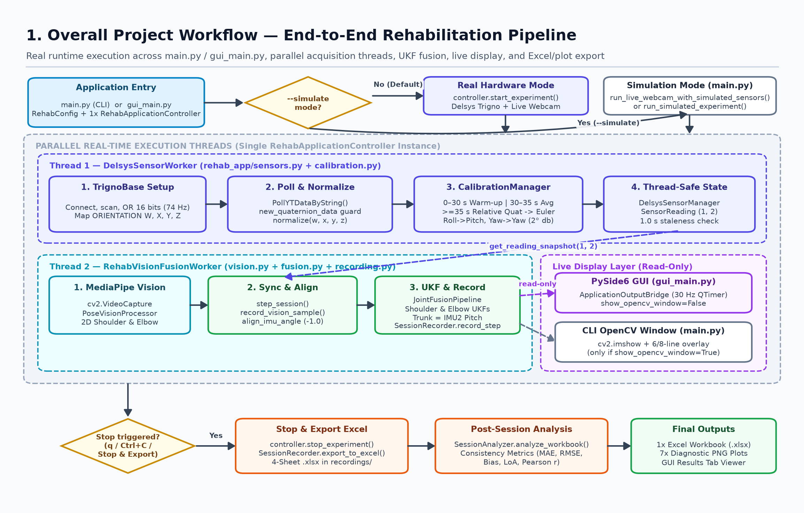
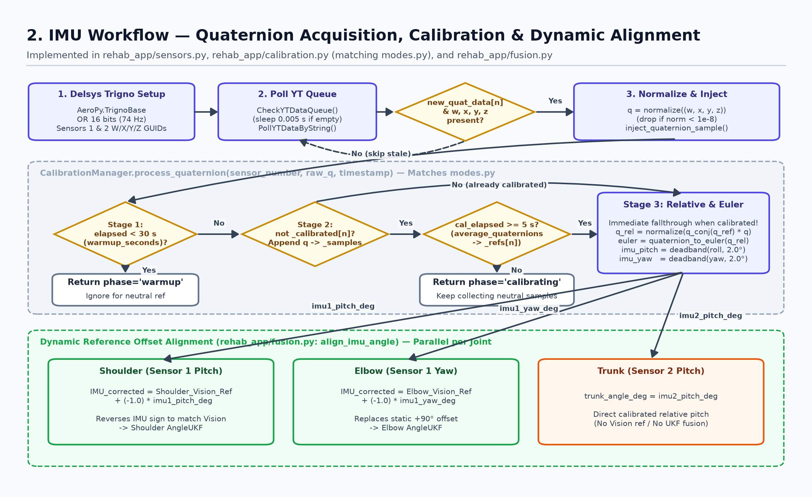
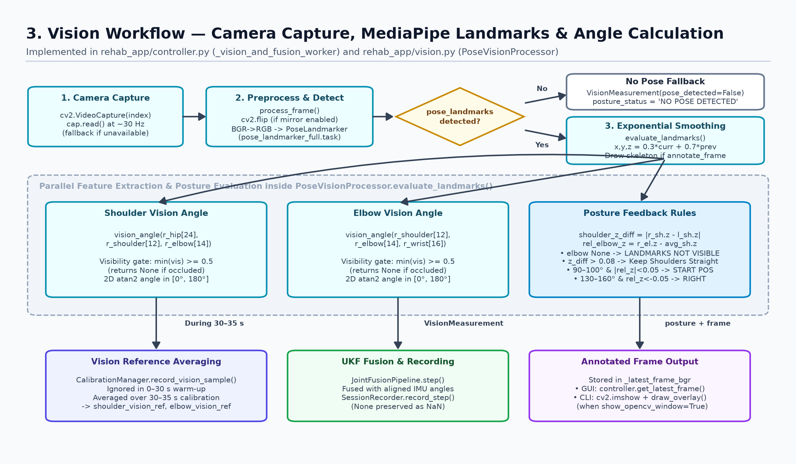
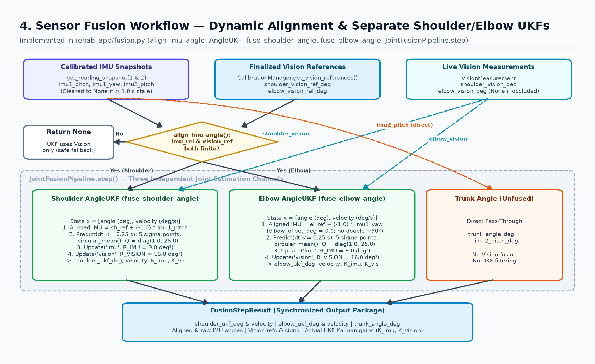
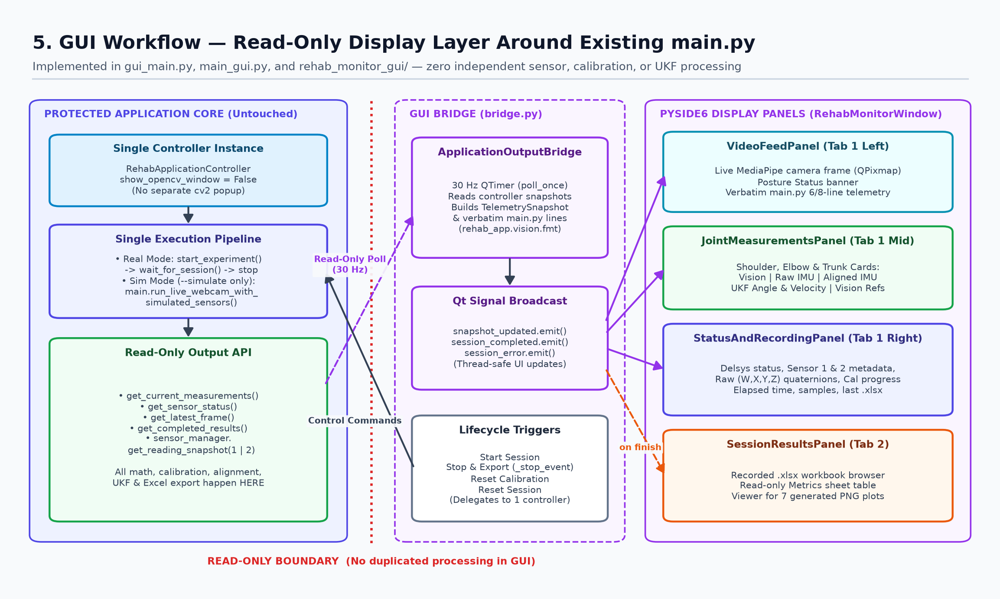
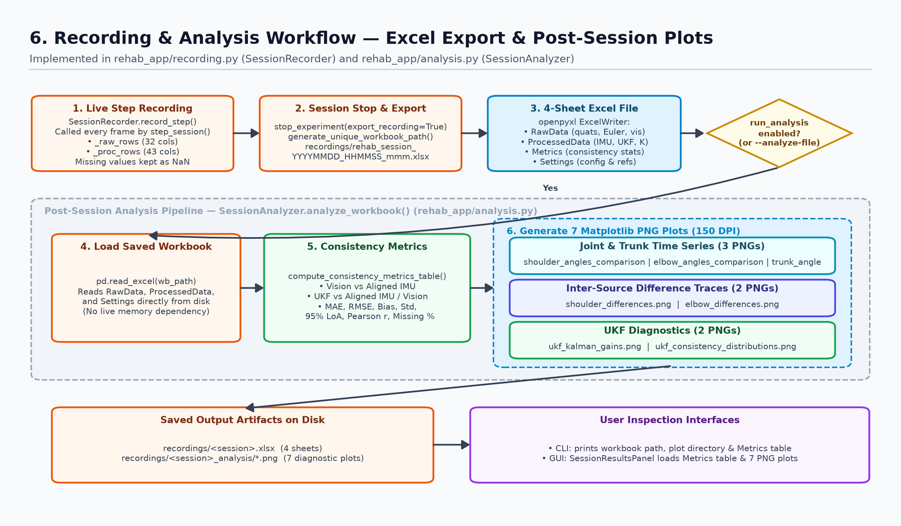

# 🦾 Active Upper-Limb Rehabilitation System (MediaPipe Vision + Delsys Trigno IMUs + UKF Fusion)


A modular Python rehabilitation monitoring, sensor-fusion, and recording application combining **MediaPipe Pose** computer vision with **Delsys Trigno** wireless orientation sensors (`OR 16 bits (74 Hz)` quaternion streaming).

The system performs a **30 s stationary warm-up + 5 s neutral calibration** (matching [`modes.py`](modes.py)), captures **dynamic Vision reference angles** for Shoulder and Elbow alignment, fuses upper-limb joint angles in real time using **Unscented Kalman Filters (UKFs)**, exports every session to a **4-sheet Excel workbook**, and generates **7 post-experiment diagnostic plots**.

It can be run either through the **Command-Line Interface ([`main.py`](main.py))** or through the standalone **PySide6 Graphical User Interface ([`gui_main.py`](gui_main.py) / [`main_gui.py`](main_gui.py))**.

---

## 📑 Table of Contents

- [📂 Project Structure](#-project-structure)
- [🧠 System Architecture & Data Flow](#-system-architecture--data-flow)
- [⚙️ Prerequisites & Installation](#️-prerequisites--installation)
- [🚀 Quick Start — How to Run](#-quick-start--how-to-run)
- [🖥️ GUI vs. CLI Relationship](#️-gui-vs-cli-relationship)
- [📊 Session Recording & Analysis Outputs](#-session-recording--analysis-outputs)
- [🧪 Testing & Verification](#-testing--verification)
- [🧭 Where to Modify Things](#-where-to-modify-things)
- [📄 License](#-license)

---

## 📂 Project Structure

```text
Python/
├── rehab_app/                          # Core modular rehabilitation package (GUI-independent)
│   ├── README.md                       # Detailed core module, math, and debugging guide
│   ├── __init__.py                     # Public package exports
│   ├── config.py                       # Default constants, direction signs, and RehabConfig
│   ├── calibration.py                  # Quaternion math, modes.py calibration, Vision ref averaging
│   ├── sensors.py                      # Delsys Trigno connection, OR 16 bits mode, WXYZ polling
│   ├── vision.py                       # MediaPipe PoseLandmarker, smoothing, 2D angles, overlay
│   ├── fusion.py                       # Dynamic IMU alignment, AngleUKF, JointFusionPipeline
│   ├── recording.py                    # SessionRecorder and 4-sheet Excel workbook export
│   ├── analysis.py                     # Excel-loaded consistency metrics and 7 Matplotlib plots
│   └── controller.py                   # RehabApplicationController coordinating all subsystems
├── rehab_monitor_gui/                  # Standalone PySide6 GUI display layer (read-only over main.py)
│   ├── README.md                       # Complete GUI setup, layout, architecture & troubleshooting
│   ├── __init__.py                     # GUI package exports
│   ├── bridge.py                       # 30 Hz read-only Qt output bridge around RehabApplicationController
│   ├── widgets.py                      # VideoFeedPanel, JointMeasurementsPanel, Status & Results panels
│   ├── main_window.py                  # RehabMonitorWindow (header controls + 2-tab dashboard)
│   └── styles.py                       # Dark-slate clinical QSS theme and Images/ asset paths
├── tests/                              # Automated unit, pipeline, and GUI verification suite
│   ├── README.md                       # Test descriptions, commands, and failure diagnosis
│   ├── test_rehab_app.py               # Mathematical parity, dynamic alignment, recording & analysis tests
│   ├── test_rehab_monitor_gui.py       # Offscreen-Qt tests for rehab_monitor_gui parity with main.py
│   └── test_rehab_gui.py               # Legacy test file from removed rehab_gui/ package
├── Images/                             # Visual assets (delsys.png, window_icon.png) & workflow diagrams
│   └── diagrams/                       # 6 PNG architecture & execution workflow diagrams
├── AeroPy/                             # Delsys AeroPy .NET wrapper (TrignoBase.py, DataManager.py)
├── resources/                          # DelsysAPI.dll and .NET runtime dependencies
├── recordings/                         # Exported Excel workbooks (.xlsx) and analysis plot folders
├── DataCollector/ Export/ Plotter/ StartMenu/ UIControls/  # Original Delsys demo modules (preserved)
├── main.py                             # Primary CLI entry point (live, --simulate, --gui, --analyze-file)
├── gui_main.py                         # Primary PySide6 GUI launcher (also called by main.py --gui)
├── main_gui.py                         # Convenience alias delegating to gui_main.launch_gui()
├── modes.py                            # Reference Delsys orientation/calibration implementation
├── rehab_vision_delsys_ukf_Final.py    # Original single-file reference implementation (preserved)
├── DelsysPythonDemo.py                 # Original Delsys EMG demo entry point (preserved)
├── pose_landmarker_full.task           # MediaPipe PoseLandmarker model asset
├── requirements.txt                    # Python package dependencies
├── UPDATE_1.md                         # Design notes for dynamic IMU-to-Vision offset alignment
└── LICENSE                             # Delsys, Inc. API License Agreement
```

### 📚 Folder-Specific Documentation
- **[`rehab_app/README.md`](rehab_app/README.md)** — Core modules, classes, mathematical equations, calibration & alignment logic, and independent debugging.
- **[`rehab_monitor_gui/README.md`](rehab_monitor_gui/README.md)** — Complete guide to the new PySide6 GUI, data flow from `main.py`, layout, CLI flags, and troubleshooting.
- **[`tests/README.md`](tests/README.md)** — Automated test suite breakdown, execution commands, and how to add new tests.

---

## 🧠 System Architecture & Data Flow

### 1. Overall Project Workflow


### 2. Subsystem Workflow Diagrams

| Workflow | Diagram |
| :--- | :--- |
| **IMU Acquisition, Calibration & Dynamic Alignment** |  |
| **Vision (MediaPipe Pose) Pipeline** |  |
| **Sensor Fusion & Separate Shoulder/Elbow UKFs** |  |
| **Read-Only PySide6 GUI Architecture** |  |
| **Recording & Post-Session Analysis Pipeline** |  |

<details>
<summary>Text Summary of Core Data Pipeline</summary>

```text
[Delsys Trigno Sensors 1 & 2] (OR 16 bits, 74 Hz)
       │  ORIENTATION W, X, Y, Z quaternion packets (per-poll new_quaternion_data guard)
       ▼
[rehab_app/sensors.py: DelsysSensorManager]
       │  Normalizes (W, X, Y, Z) -> CalibrationManager
       ▼
[rehab_app/calibration.py: CalibrationManager] (matches modes.py)
       │  1. Stage 1 (0–30 s): Stationary Warm-up
       │  2. Stage 2 (30–35 s): Neutral quaternion averaging -> q_ref
       │     + Simultaneous Shoulder & Elbow Vision reference averaging (record_vision_sample)
       │  3. Stage 3 (>=35 s): Immediate fallthrough -> q_rel = normalize(q_conj(q_ref) * q)
       │     • imu_pitch = deadband(mathematical_roll, 2.0°)
       │     • imu_yaw   = deadband(mathematical_yaw, 2.0°)
       ▼
[rehab_app/controller.py: RehabApplicationController.step_session()] ◄── [rehab_app/vision.py: PoseVisionProcessor]
       │                                                                  • MediaPipe PoseLandmarker
       │                                                                  • Exponential smoothing (alpha = 0.3)
       │                                                                  • 2D Shoulder & Elbow Vision angles
       ▼
[rehab_app/fusion.py: JointFusionPipeline.step()]
       │  Dynamic Alignment: IMU_corrected = Vision_reference + direction_sign * IMU_relative
       │  • Shoulder (sign = -1.0): Aligned IMU 1 Pitch + Shoulder Vision -> Shoulder UKF
       │  • Elbow    (sign = -1.0): Aligned IMU 1 Yaw   + Elbow Vision    -> Elbow UKF
       │  • Trunk:                  IMU 2 Pitch passed through directly (unfused)
       ▼
[rehab_app/recording.py: SessionRecorder] ──► recordings/rehab_session_YYYYMMDD_HHMMSS_mmm.xlsx
       │                                      (Sheets: RawData | ProcessedData | Metrics | Settings)
       ▼
[rehab_app/analysis.py: SessionAnalyzer]  ──► 7 PNG diagnostic plots in recordings/<session>_analysis/
```

</details>

---

## ⚙️ Prerequisites & Installation

1. **System Requirements:**
   - Windows OS (required for `pythonnet` and `resources/DelsysAPI.dll` when using physical Delsys Trigno hardware).
   - Python 3 (verified on **Python 3.13**).
   - Webcam (optional in `--simulate --no-vision` mode).
   - Delsys Trigno RF base station + 2 paired orientation-capable Trigno sensors (optional in `--simulate` mode).
2. **Install Python Dependencies** from the `Python/` directory:
   ```powershell
   pip install -r requirements.txt
   ```
   Dependencies in [`requirements.txt`](requirements.txt): `PySide6`, `Vispy`, `Scipy`, `pythonnet`, `numpy`, `opencv-python`, `mediapipe`, `pandas`, `openpyxl`, `matplotlib`.
3. **Verify Required Assets:** Ensure `pose_landmarker_full.task` is present in the `Python/` root directory (and `resources/DelsysAPI.dll` if connecting physical Delsys hardware).

---

## 🚀 Quick Start — How to Run

Run all commands from the `Python/` root directory.

### 🖥️ Launch the PySide6 GUI
```powershell
# Standard launch (ready for real Delsys hardware + live webcam)
python gui_main.py
```
*(You can also launch via `python main_gui.py` or `python main.py --gui`.)*

```powershell
# Launch GUI in Simulation Mode with fast 3 s warm-up + 2 s calibration (no Delsys hardware needed)
python gui_main.py --simulate --warmup 3 --calibration 2
```

### 📷 Run the Standalone CLI (`main.py`)
```powershell
# 1. Live webcam + real Delsys Trigno sensors (opens OpenCV window; press 'q' to stop & export)
python main.py

# 2. Live webcam + simulated Delsys sensors
python main.py --simulate --warmup 5 --calibration 3 --duration 60

# 3. Headless simulation (no webcam or sensors required)
python main.py --simulate --no-window --no-vision --warmup 2 --calibration 1 --duration 4

# 4. Re-analyze an existing saved Excel workbook
python main.py --analyze-file recordings/<session_file>.xlsx
```

---

## 🖥️ GUI vs. CLI Relationship

- **[`main.py`](main.py)** is the core CLI application. When run with `--show-window` (default), it opens an OpenCV window displaying MediaPipe landmarks, posture status, and a 6-line (during calibration) or 8-line (after calibration) telemetry overlay.
- **[`rehab_monitor_gui/`](rehab_monitor_gui/README.md)** is a **read-only PySide6 display layer** built around a single `RehabApplicationController` instance with `show_opencv_window=False`. It never duplicates sensor polling, calibration, alignment, or UKF math—it reads live outputs directly from `controller.get_current_measurements()`, `controller.get_sensor_status()`, `controller.get_latest_frame()`, and `controller.get_completed_results()` at 30 Hz.
- Both interfaces produce **identical calibration references, aligned IMU readings, UKF outputs, Trunk angles, Excel workbooks, and analysis plots**.

---

## 📊 Session Recording & Analysis Outputs

When a session stops (pressing `q` / `Ctrl+C` in `main.py`, or clicking **Stop & Export** in the GUI):
1. A uniquely named workbook is saved to `recordings/rehab_session_YYYYMMDD_HHMMSS_mmm.xlsx` with **4 sheets**:
   - `RawData` (32 columns): raw `(W, X, Y, Z)` quaternions, mathematical Euler angles, calibration phases, raw vision angles, landmark visibilities, and status strings.
   - `ProcessedData` (43 columns): raw & dynamically aligned IMU angles, Vision references, direction signs, Vision angles, Shoulder/Elbow UKF angles & velocities, unfused Trunk angle, inter-source differences, and UKF Kalman gains.
   - `Metrics`: pairwise inter-source consistency metrics (`MAE`, `RMSE`, `Bias`, `Std`, `95% LoA`, `Pearson_r`, missing-data `%`) plus single-channel summaries.
   - `Settings`: full `RehabConfig` snapshot, reference quaternions, Vision calibration references, and sensor metadata.
2. `SessionAnalyzer` generates **7 diagnostic PNG plots** in `recordings/<workbook_stem>_analysis/`:
   - `shoulder_angles_comparison.png`, `elbow_angles_comparison.png`, `trunk_angle.png`
   - `shoulder_differences.png`, `elbow_differences.png`
   - `ukf_kalman_gains.png`, `ukf_consistency_distributions.png`

---

## 🧪 Testing & Verification

Run the active automated unit, pipeline, and offscreen-Qt GUI test suites (no physical hardware or webcam required):

```powershell
python -m unittest tests.test_rehab_app tests.test_rehab_monitor_gui -v
```

See [`tests/README.md`](tests/README.md) for the full breakdown of all test cases and troubleshooting tips.

---

## 🧭 Where to Modify Things

| If you want to modify... | File | Function / Class |
| :--- | :--- | :--- |
| **GUI visual theme, colors, or `Images/` assets** | [`rehab_monitor_gui/styles.py`](rehab_monitor_gui/styles.py) | `COLORS`, `build_app_stylesheet()` |
| **GUI layout, panels, or displayed fields** | [`rehab_monitor_gui/widgets.py`](rehab_monitor_gui/widgets.py) & [`rehab_monitor_gui/main_window.py`](rehab_monitor_gui/main_window.py) | `VideoFeedPanel`, `JointMeasurementsPanel`, `StatusAndRecordingPanel`, `RehabMonitorWindow` |
| **GUI polling rate or controller bridge** | [`rehab_monitor_gui/bridge.py`](rehab_monitor_gui/bridge.py) | `ApplicationOutputBridge` |
| **Default timings, direction signs (`-1.0`), or UKF variances** | [`rehab_app/config.py`](rehab_app/config.py) | `SHOULDER_IMU_DIRECTION_SIGN`, `ELBOW_IMU_DIRECTION_SIGN`, `RehabConfig` |
| **Quaternion math, neutral calibration, or Vision reference averaging** | [`rehab_app/calibration.py`](rehab_app/calibration.py) | `CalibrationManager.process_quaternion()`, `record_vision_sample()` |
| **Delsys `OR 16 bits` mode, WXYZ polling, or staleness timeout** | [`rehab_app/sensors.py`](rehab_app/sensors.py) | `DelsysSensorManager._sensor_worker_loop()` |
| **MediaPipe landmarks, 2D angles, or posture feedback rules** | [`rehab_app/vision.py`](rehab_app/vision.py) | `PoseVisionProcessor.evaluate_landmarks()` |
| **Dynamic IMU alignment or UKF equations** | [`rehab_app/fusion.py`](rehab_app/fusion.py) | `align_imu_angle()`, `AngleUKF`, `JointFusionPipeline.step()` |
| **Excel sheet schemas or consistency metrics** | [`rehab_app/recording.py`](rehab_app/recording.py) | `RAW_COLUMNS`, `PROCESSED_COLUMNS`, `compute_consistency_metrics_table()` |
| **Post-experiment Matplotlib plots** | [`rehab_app/analysis.py`](rehab_app/analysis.py) | `SessionAnalyzer.analyze_workbook()` |

---

## 📄 License

This project uses the Delsys Trigno API under the terms of the **[Delsys, Inc. Application Programming Interfaces License Agreement](LICENSE)**.
